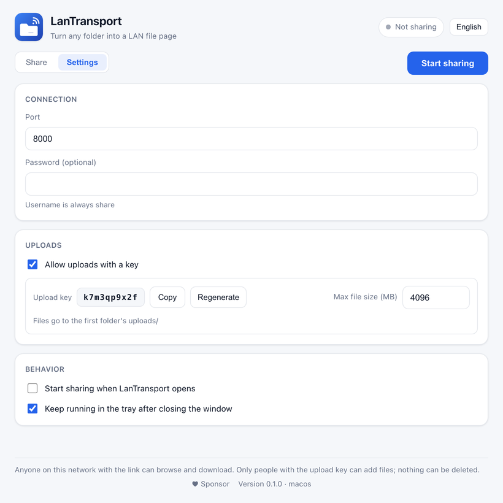
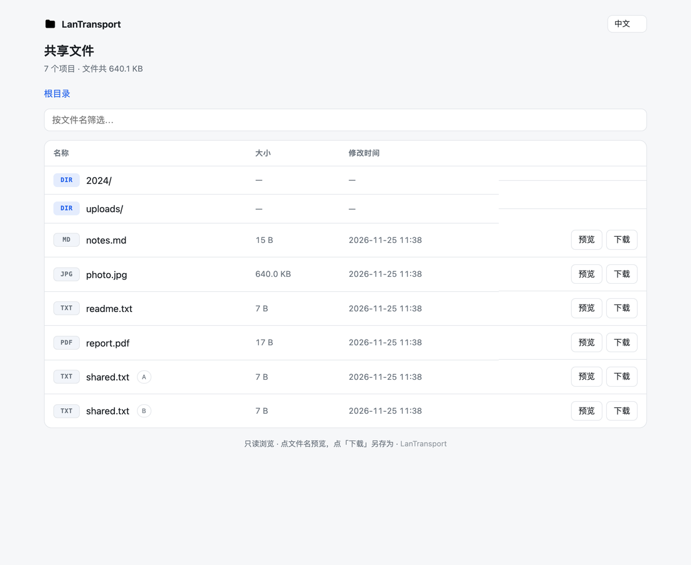

# LanTransport

Share files across your local network from a small desktop app.

Pick a folder, press **Start sharing**, and anyone on the same Wi‑Fi can open the
link in a browser to browse and download. Read-only by default. People you give
an **upload key** can also drop files into the folder they are viewing.

No account, no cloud, no relay: the files never leave your network.

```
┌──────────────────────────────────────────┐
│  LanTransport               ●  Sharing   │
│                                          │
│  Folder                                  │
│  /Users/me/Downloads           [Choose…] │
│  Port 8787      [x] Allow LAN access     │
│                                          │
│  [x] Allow uploads with a key            │
│      k7m3qp9x2f   [Copy] [Regenerate]    │
│                                          │
│  http://192.168.1.24:8787  [Copy]        │
└──────────────────────────────────────────┘
```

## Features

- **Share several folders at once** — their contents appear as one merged listing;
  files with the same name are labeled by source folder
- **Browser UI** for any phone, tablet or computer — no app needed on the other side
- **Read-only by default**: browse, preview, download; Range requests so downloads resume
- **Sortable list**: name, size or modified time, ascending or descending
- **Optional password** for browsing (HTTP Basic, username `share`)
- **Key-gated uploads**: rotate the key anytime; files land in the first folder's `uploads/`
- **QR code** for the LAN link, one click to copy
- **Tray app**: keeps sharing while the window is closed; start/stop from the tray
- **Always LAN-bound**: the server listens on your local network; there is no local-only mode to misconfigure
- **Cross-platform**: macOS (Intel & Apple Silicon), Windows, Linux
- Light/dark follows the system; English and 中文 today, more via [Weblate](docs/TRANSLATING.md)
- Small installers: the app uses the system webview instead of bundling a browser

## Screenshots

| Sharing | Settings |
|---|---|
|  |  |

| Phone | Desktop |
|---|---|
|  |  |

## Install

### Homebrew (macOS)

```bash
brew install --cask welpher/tap/lantransport
```

### winget (Windows)

```powershell
winget install welpher.LanTransport
```

### Arch Linux (AUR)

```bash
yay -S lantransport-bin
```

### Direct downloads

| Platform | File |
|---|---|
| macOS | `.dmg` (universal) |
| Windows | `.exe` (NSIS) or `.msi` |
| Linux | `.AppImage`, `.deb`, `.rpm` |

Builds are not code-signed yet, so macOS Gatekeeper and Windows SmartScreen will
warn on first launch. On macOS: right-click the app → **Open**.

## How it works

A small HTTP server is embedded in the app (Rust, no runtime to install). The UI
is Tauri 2 + the system webview. Requests are served straight from the chosen
folder; nothing is copied or indexed.

Security model, limits and known caveats live in [SECURITY.md](SECURITY.md).

## Development

Prerequisites: Node 20+, pnpm, Rust stable, and the
[Tauri prerequisites](https://tauri.app/start/prerequisites/) for your OS.

```bash
pnpm install
pnpm tauri dev          # desktop app with hot reload
pnpm tauri build        # installers in src-tauri/target/release/bundle
cargo test --manifest-path src-tauri/Cargo.toml
pnpm icons              # regenerate app/tray icons from assets/*.svg
pnpm preview:ui         # UI only, mocked IPC → http://localhost:1421/?mode=running&uploads=1
pnpm i18n:check         # verify locales/*.json keys and placeholders
```

Layout:

```
src/                     UI (vanilla TypeScript + Vite)
locales/                 one catalog per language, shared by app and web page
                         (drop a new <code>.json in and the pickers pick it up)
src-tauri/src/server/    embedded HTTP server (listing, downloads, uploads, auth)
src-tauri/src/           Tauri shell: tray, settings, commands
```

## Sponsor

LanTransport is free and MIT-licensed. Tips are voluntary and pay for the boring
parts that keep releases trustworthy: macOS notarization, Windows code signing,
and release infrastructure.

- [Alipay / WeChat Pay QR codes and other ways to help](SUPPORT.md)

[](SUPPORT.md)

## Roadmap

See [docs/ROADMAP.md](docs/ROADMAP.md). Near-term: code signing, auto-update,
per-folder links, upload history and a clipboard channel.

## License

MIT © 2026 welpher
